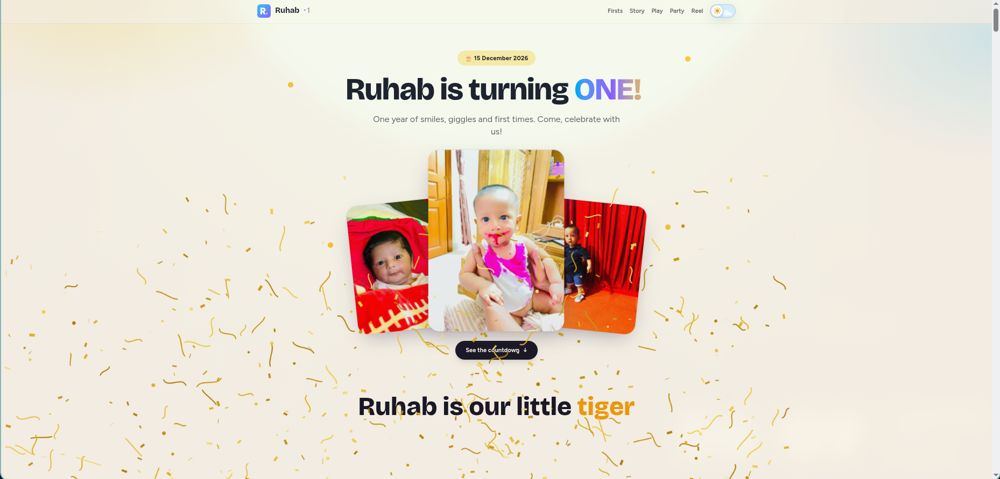

<div align="center">

# 🎂 Ruhab turns ONE!

**A playful, animated birthday landing page for Ruhab's 1st birthday (15 December 2026).**

React 18 · Vite 6 · Tailwind CSS 4 · Framer Motion



</div>

---

## ✨ Features

- **Welcome intro**: "Congratulations!" and "Happy Birthday Ruhab!" typing on a white screen with gold confetti. It lasts **3 seconds** and shows only on a visitor's first visit.
- **Live countdown** with rolling digits, aimed at midnight of 15 Dec 2026 (Bangladesh time, UTC+6).
- **49 photos** in a story, timeline, bento grid, orbit, polaroid table, carousel, panel gallery and story reel.
- **Day / night mode** with a circular reveal animation. The page always starts in day mode.
- **Full-screen photo viewer** (lightbox) with keyboard arrows and Esc.
- **Fun parts**: pop balloons to read wishes, blow out the cake candle, drag the polaroids around.
- **Accessible**: keyboard friendly, proper labels, and it respects `prefers-reduced-motion`.
- **Mobile first**, responsive on every screen size.
- All text lives in one file, `src/site.js`.

---

## 🧱 Tech stack

| Part | Tool |
| --- | --- |
| UI | React 18 |
| Build | Vite 6 |
| Styling | Tailwind CSS 4 (`@tailwindcss/vite`) |
| Animation | Framer Motion 11 |
| Fonts | Bricolage Grotesque (headings), Figtree (text) via `@fontsource-variable` |
| Hosting | Vercel (`vercel.json` adds long cache headers for photos and assets) |

No other packages are needed. The components take their ideas from [motion-brew.com](https://motion-brew.com) and are written with Framer Motion only.

---

## 🚀 Quick start

```bash
npm install
npm run dev        # http://localhost:5173  (intro shows on every reload in dev)
npm run build      # production build in /dist
npm run preview    # test the production build locally
```

> **Tip:** add `?intro` to any URL (for example `/?intro`) to see the welcome intro again in production.

---

## 📁 Project structure

```bash
ruhab-landing/
├── docs/
│   └── screenshot.png          # preview image used in this README
├── public/
│   ├── favicon.svg             # site icon (also used in the header logo)
│   ├── favicon.ico
│   ├── favicon-32.png
│   ├── apple-touch-icon.png
│   └── photos/                 # 49 photos x 2 sizes = 98 .webp files
│       ├── <id>.webp           #   big version, used by the photo viewer
│       └── <id>-m.webp         #   medium version, used on the page
├── src/
│   ├── main.jsx                # entry: fonts + renders <App />
│   ├── App.jsx                 # page layout: all sections in order
│   ├── site.js                 # ALL the text, chapters, milestones, captions
│   ├── photos.js               # photo list (id, size, alt text)
│   ├── theme.js                # day / night logic (circle reveal animation)
│   ├── index.css               # Tailwind + colour variables + keyframes
│   └── components/
│       ├── Intro.jsx           # 3-second welcome intro (typing + confetti)
│       ├── Confetti.jsx        # gold confetti canvas
│       ├── ThemeToggle.jsx     # animated sun / moon switch
│       ├── fx.jsx              # BlurText, Reveal, TiltCard, Countdown, Lightbox
│       ├── party.jsx           # Orbit, Cake, Balloons, PolaroidTable, Recap
│       ├── tilt-carousel.jsx   # looping 3D photo carousel
│       └── sections.jsx        # FlipWords, ThenNow, Timeline, Favourites,
│                               # Blessings, StoryReel, PanelGallery,
│                               # ScrollProgress, MagneticButton
├── index.html                  # page title, meta tags, early dark-mode script
├── vercel.json                 # cache headers for /photos and /assets
├── vite.config.js              # React + Tailwind plugins, "@" alias to /src
├── package.json
└── README.md
```

---

## 🗺️ Page sections (top to bottom)

| # | Section | Component | Edit in `site.js` |
| - | --- | --- | --- |
| 1 | Hero with tilt photo cards | `App.jsx` | `heroLine`, `tagline`, `badge` |
| 2 | "Ruhab is our little ..." flipping words | `FlipWords` | `flipPrefix`, `flipWords` |
| 3 | Countdown | `Countdown` | `birthday`, `countdownTitle` |
| 4 | Recap numbers (days, photos) | `Recap` | `birthDate`, `recapTitle` |
| 5 | A year of firsts (scroll timeline) | `Timeline` | `milestones` |
| 6 | Story chapters (photo masonry) | `App.jsx` | `chapters` |
| 7 | Then and now (drag slider) | `ThenNow` | `thenLabel`, `nowLabel` |
| 8 | Orbit of photos around a big "1" | `Orbit` | ids in `App.jsx` |
| 9 | Photo table (drag polaroids) | `PolaroidTable` | ids in `App.jsx` |
| 10 | Favourite things (bento grid) | `Favourites` | `favourites` |
| 11 | More little moments (3D carousel) | `TiltCarousel` | `momentsTitle` |
| 12 | Panel gallery (hover to open wide) | `PanelGallery` | `panels` |
| 13 | Pop a balloon, read a wish | `Balloons` | `wishes` |
| 14 | Make a wish (cake and candle) | `Cake` | `cakeTitle`, `cakeNote` |
| 15 | Blessings (avatars and quotes) | `Blessings` | `blessings` |
| 16 | Mama's message | `App.jsx` | `mamaTitle`, `mamaNote` |
| 17 | Party invitation and "Add to calendar" | `App.jsx` | `partyTitle`, `time`, `venue` |
| 18 | Story reel (tap through like stories) | `StoryReel` | `reel` |
| 19 | Footer | `App.jsx` | `footerTitle`, `madeBy` |

---

## ✏️ Change the text

Open **`src/site.js`**. Save, and the page updates by itself.

```js
export const site = {
  name: "Ruhab",
  birthday: "2026-12-15",   // countdown target (midnight, Bangladesh time)
  birthDate: "2025-12-15",  // used for "days of love"
  time: "",                 // e.g. "6:00 PM" (empty = hidden)
  venue: "",                // e.g. "Our home, Chattogram" (empty = hidden)
  // ...
};
```

Other lists in the same file: `chapters`, `milestones`, `favourites`, `panels`, `reel`, `blessings`, `wishes`. They all point to photos by **id**.

---

## 🖼️ Add or change photos

1. Resize the photo to two files: a big one (about 1125 x 1500) and a medium one (about 570 x 760), as `.webp`.
2. Put them in `public/photos/` as `my-photo.webp` and `my-photo-m.webp`.
3. Add one line to `src/photos.js`:
   ```js
   ["my-photo", 1125, 1500, "Describe the photo for screen readers"],
   ```
4. Use the id (`"my-photo"`) in any list in `src/site.js`.

Quick conversion with Python:

```bash
python3 - <<'PY'
from PIL import Image, ImageOps
im = ImageOps.exif_transpose(Image.open("input.jpg")).convert("RGB")
big = im.copy();  big.thumbnail((1125, 1500)); big.save("my-photo.webp", "WEBP", quality=80)
med = im.copy();  med.thumbnail((570, 760));   med.save("my-photo-m.webp", "WEBP", quality=78)
PY
```

---

## ⏱️ Welcome intro

File: `src/components/Intro.jsx`

```js
const SECOND_LINE_AT = 1300; // second line starts
const TEXT_END       = 2500; // white screen starts fading (gone by about 3s)
const CONFETTI_MS    = 3000; // confetti keeps falling until here
const TYPE_MS        = 50;   // delay between typed letters
```

- Visitors see it only once (remembered in `localStorage`).
- `npm run dev` shows it on every reload. In production add `?intro` to the URL.
- The hero text waits for the intro to end (`intro ? 2.8 : 0.1` in `App.jsx`). If you change the intro time, change these numbers too.

---

## 🌗 Day / night mode

- Colours are CSS variables in `src/index.css` (`--ink`, `--mist`, `--surface`). The `dark` class on `<html>` flips them.
- A small script in `index.html` applies a saved night choice before the first paint, so there is no flash.
- Cards that should follow the theme use `bg-surface text-ink`.

---

## ☁️ Deploy to Vercel

1. Push the project to GitHub.
2. Import the repo in Vercel. Framework: **Vite**. Build command: `npm run build`. Output: `dist`.
3. Every `git push` redeploys the site.

**Photos missing on Vercel?** They were probably never pushed. Check that `.gitignore` does **not** contain `photos/`:

```bash
git check-ignore -v public/photos/berry-face.webp   # prints a line = still ignored
git add -f public/photos .gitignore
git commit -m "add photos" && git push
```

If the project is in a subfolder of your repo, set Vercel's **Root Directory** to that folder.

---

## 🙏 Credits

Made with love by **Mama Sakib, Abbu Tanim & Ammu Mishu** for Ruhab.
Animation ideas inspired by [Motion Brew](https://motion-brew.com).
